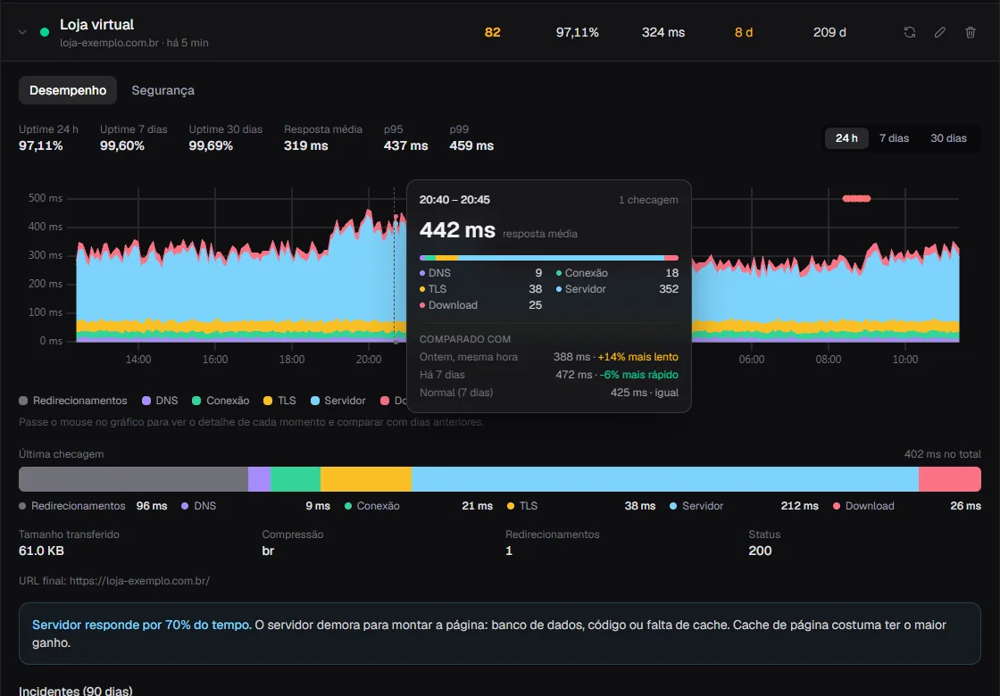
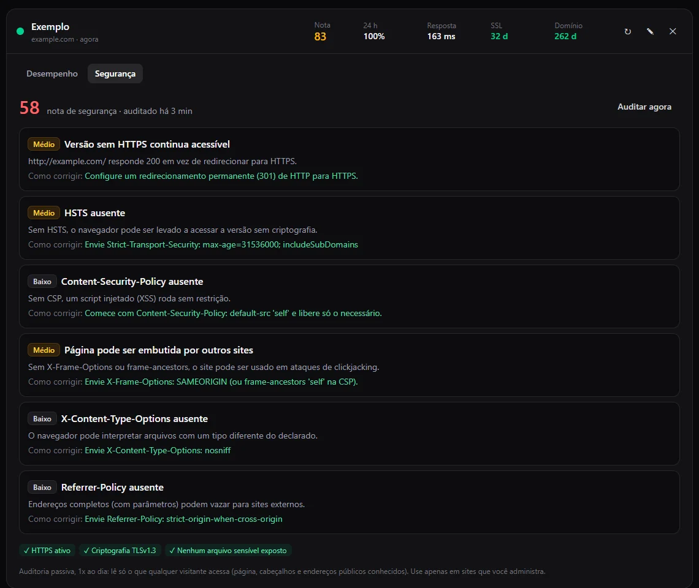

<div align="center">

# Uptrue

**Seu site está no ar de verdade?**

Monitor de saúde de sites, self-hosted e open source. Vai além do uptime: auditoria de segurança diária, detecção de adulteração, SSL e vencimento de domínio (inclusive `.com.br` no Registro.br), com uma nota de saúde de 0 a 100 e alertas no Telegram.

[](https://github.com/gusmcardoso/uptrue/actions/workflows/ci.yml)
[](LICENSE)


[Português](#português) · [English](#english)

</div>


---

## Português

### Por que mais um monitor?

Monitores tradicionais perguntam só *"o servidor respondeu?"*. O problema de quem mantém sites de clientes costuma ser outro: o site responde 200, mas a página está em branco, o SSL vence semana que vem ou o domínio expira sem ninguém perceber. O Uptrue responde **"o site está saudável, seguro e funcionando para o cliente?"**: o Uptime Kuma diz se o servidor respondeu; o Uptrue também diz se o `.env` vazou, se apareceu um script estranho na página ou se o certificado vence semana que vem.

### O que o Uptrue faz

| Recurso | Detalhe |
| --- | --- |
| Checagem HTTP | Status, tempo de resposta e redirecionamentos, de 30 s a 1 h por site |
| **Onde o tempo foi gasto** | Cada checagem mede redirecionamentos, DNS, conexão, TLS, espera do servidor e download; gráfico em camadas, cascata da última checagem, p50/p95/p99, tamanho, compressão e um diagnóstico de qual etapa pesa mais e o que fazer (v0.1.3) |
| Palavra-chave | Opcional: só conta como no ar se o texto aparecer na página (pega página em branco com 200) |
| Confirmação de queda | Só declara "fora do ar" após 2 falhas seguidas, sem alarme falso |
| Certificado SSL | Dias até vencer, emissor e validade da cadeia; avisos com 14 e 3 dias |
| Vencimento de domínio | Via RDAP no servidor oficial de cada extensão (`.br` direto no Registro.br); avisos com 30 e 7 dias |
| Incidentes | Início, fim e duração de cada queda, com histórico de 90 dias |
| Painel | Uptime de 24 h, 7 e 30 dias, gráfico de tempo de resposta e vencimentos |
| Alertas | Telegram: queda, volta (com duração) e vencimentos, sem repetir aviso |
| **Auditoria de segurança** | 1x ao dia: arquivos sensíveis expostos (`.env`, `.git`, backups, dumps SQL, `phpinfo`), cabeçalhos de segurança, HTTPS e redirecionamento, TLS obsoleto, conteúdo misto, listagem de diretório e versão do servidor exposta, cada achado com **como corrigir** (v0.1.2) |
| **Detecção de adulteração** | Script externo de domínio novo na página ou termos típicos de invasão (\"hacked by\", spam de cassino) viram alerta (v0.1.2) |
| **Nota de saúde 0–100** | Disponibilidade (40) + segurança (40) + validade de SSL e domínio (20) (v0.1.2) |
| Página de status pública | `/status`, só com os sites marcados como públicos: estado atual e barras de 90 dias (v0.1.1) |
| Métricas Prometheus | `/metrics` protegido por token, pronto para o Grafana (v0.1.1) |

### Rodando com Docker

```bash
curl -O https://raw.githubusercontent.com/gusmcardoso/uptrue/main/compose.yml
curl -o .env https://raw.githubusercontent.com/gusmcardoso/uptrue/main/.env.example
# edite o .env: AUTH_SECRET (obrigatório) e, se quiser alertas, o Telegram
docker compose up -d
```

Abra `http://localhost:3000` e crie a conta de administrador no primeiro acesso. A imagem é publicada para **amd64 e arm64**, então roda também em Raspberry Pi e nas VMs ARM gratuitas da Oracle Cloud.

| Variável | Obrigatória | Descrição |
| --- | --- | --- |
| `AUTH_SECRET` | sim | Assina o cookie de sessão (mín. 16 caracteres) |
| `TELEGRAM_BOT_TOKEN` / `TELEGRAM_CHAT_ID` | não | Alertas no Telegram (sem eles, os alertas vão para o log) |
| `ADMIN_EMAIL` / `ADMIN_PASSWORD` | não | Cria o admin na subida, em vez do cadastro pelo painel |
| `RETENTION_DAYS` | não | Dias de histórico de checagens (padrão 90) |
| `CHECK_CONCURRENCY` | não | Checagens simultâneas (padrão 10) |
| `STATUS_PAGE_TITLE` | não | Título da página de status pública (padrão "Status dos serviços") |
| `METRICS_TOKEN` | não | Habilita o `/metrics` para o Prometheus (sem ele, o endpoint fica desligado) |

### Onde o tempo foi gasto

"Respondeu em 420 ms" não diz o que fazer. O Uptrue abre uma **conexão nova a cada checagem** (sem reaproveitar, para não mascarar DNS e TLS) e mede cada etapa separadamente. Se o servidor responde por mais de 40% do tempo, o painel diz isso e sugere o caminho (cache, CDN, DNS mais rápido, compressão).



Proteções do cliente HTTP: no máximo 5 redirecionamentos, 5 MB de download medido, tempo limite valendo para a requisição inteira e teto de 10 MB na descompressão (uma "bomba de compressão" não derruba o monitor).

### Auditoria de segurança

Abra um site no painel e vá na aba **Segurança**: nota, achados ordenados por gravidade e o que fazer para corrigir cada um. A auditoria é **passiva**: só faz requisições GET ao que qualquer visitante já acessa, e confirma cada arquivo pelo **conteúdo** (um site que responde 200 para qualquer endereço não gera falso positivo). Use apenas em sites que você administra.



Achados graves **novos** vão para o Telegram; o mesmo achado não é repetido no dia seguinte. Se você mesmo adicionou um script (analytics, chat), clique em **Aceitar scripts atuais**.

### Observabilidade completa (Grafana)

Um comando sobe a pilha inteira, já configurada, com dashboards prontos:

```bash
# no .env: METRICS_TOKEN e GRAFANA_ADMIN_PASSWORD
docker compose --profile observability up -d    # Grafana em http://localhost:3001
```

| Serviço | Papel |
| --- | --- |
| Prometheus | Coleta as métricas do Uptrue, da máquina e dos containers (retenção de 15 dias) |
| node_exporter | CPU, memória, disco e rede do servidor |
| cAdvisor | Consumo de cada container |
| Loki + Alloy | Logs de todos os containers; os eventos do Uptrue ganham o rótulo `event` |
| Grafana | Três dashboards provisionados: **Sites**, **Servidor** e **Containers** |


Segurança: só o Grafana é publicado, e em `127.0.0.1` (para acesso externo, coloque um proxy reverso com HTTPS na frente); Prometheus, Loki e Alloy ficam na rede interna; o token do `/metrics` e a senha do Grafana entram como *secrets* do compose, lidos do `.env`; cadastro público, acesso anônimo e telemetria do Grafana desligados.

Limitações conhecidas:

- o cAdvisor precisa de modo privilegiado e do namespace de cgroup do host; o Alloy lê o socket do Docker. É o padrão dessas ferramentas, mas dá a elas acesso amplo à máquina;
- no **Docker Desktop via WSL**, o painel de containers fica vazio: os caminhos montados vêm da distro, não da VM onde o Docker roda. Num servidor Linux funciona normalmente.

`scripts/test-observability.sh` sobe a pilha e confere cada parte: alvos do Prometheus, fontes de dados, dashboards, **cada consulta de cada painel**, logs e eventos no Loki e o que fica exposto. Ele roda no CI a cada push.

### Eventos para o Loki

Incidentes e achados de segurança saem como **JSON estruturado** no log do container (`"event":"incident.opened"`, `"incident.resolved"`, `"security.finding"`). Com Grafana Alloy (ou Promtail) coletando os logs do Docker, eles chegam ao Loki e aparecem no Grafana ao lado das métricas.

### Página de status pública

Marque um site como **público** no painel e ele aparece em `http://seu-servidor:3000/status`, sem login: estado atual, uptime e barras dos últimos 90 dias. Só o nome e o domínio são expostos. Dá para colocar no rodapé do site do cliente ou no seu portfólio.


### Prometheus e Grafana

Com `METRICS_TOKEN` definido, o `/metrics` exporta `uptrue_health_score`, `uptrue_security_score`, `uptrue_site_up`, `uptrue_site_response_seconds`, `uptrue_site_uptime_ratio` (24 h, 7 e 30 dias) e os vencimentos de SSL e domínio. Exemplo de `prometheus.yml`:

```yaml
scrape_configs:
  - job_name: uptrue
    scrape_interval: 60s
    authorization:
      credentials: "<METRICS_TOKEN>"
    static_configs:
      - targets: ["uptrue:3000"]
```

Alerta de SSL perto de vencer (`expr`): `uptrue_ssl_expiry_timestamp_seconds - time() < 14 * 86400`.

### Desenvolvimento

```bash
npm install
npm run dev        # API + agendador em http://localhost:3000
npm run dev:web    # painel com hot reload em http://localhost:5173
npm test           # testes (node:test)
npm run lint && npm run typecheck
```

### Arquitetura

| Parte | Tecnologia |
| --- | --- |
| API, agendador e checagens | Node 24 + TypeScript (executado direto, sem build) + Fastify |
| Banco | SQLite nativo do Node (`node:sqlite`): um arquivo, nenhuma dependência compilada |
| Painel | React 19 + Vite + Tailwind 4, gráficos com uPlot |
| Qualidade | Biome, `tsc`, `node:test` |
| Entrega | Docker multi-stage sem root, GitHub Actions, imagem multi-arquitetura no GHCR, Dependabot |

**Pipeline** (a cada push e pull request): lint, tipos, testes e build; a pilha de observabilidade sobe inteira e cada painel é consultado; depois sobe a imagem com `docker compose` e faz um teste de ponta a ponta (painel, API protegida, cadastro, o Uptrue monitorando a si mesmo, página de status, `/metrics` com token, container sem root); na `main` e em tags `v*`, publica a imagem `amd64` + `arm64` no GHCR.

### Roadmap

- [x] **v0.1.0**: HTTP, SSL, domínio, incidentes, painel, alertas no Telegram
- [x] **v0.1.1**: página de status pública e `/metrics` para Prometheus/Grafana
- [x] **v0.1.2**: auditoria de segurança, detecção de adulteração, nota de saúde e eventos para o Loki
- [x] **v0.1.3**: tempo por etapa (DNS, conexão, TLS, servidor, download), percentis e diagnóstico
- [x] **v0.1.4**: perfil de observabilidade (Prometheus, Grafana, Loki, Alloy, node_exporter, cAdvisor) com dashboards prontos e testados no CI
- [ ] Descoberta automática de sites pelo Traefik e por labels do Docker
- [ ] Alerta no WhatsApp (opcional)
- [ ] Regressão visual (print diário comparado com o anterior)
- [ ] Navegador de verdade: erros de JavaScript, recursos quebrados e teste sintético (botão do WhatsApp, formulário)
- [ ] Relatório mensal em PDF para o cliente
- [ ] Painel em inglês

---

## English

**Is your site *really* up?** Uptrue is a self-hosted, open-source site health monitor. Beyond plain uptime, it runs a daily passive security audit (exposed `.env`/`.git`/backups, security headers, TLS, tampering detection), computes a 0–100 health score, and tracks SSL certificate expiry and domain expiry through RDAP (using each TLD's official server, including Brazil's Registro.br), and sends Telegram alerts on downtime, recovery and upcoming expirations.

- **Quick start:** grab `compose.yml` and `.env.example`, set `AUTH_SECRET`, run `docker compose up -d`, then open `http://localhost:3000` and create the admin account.
- **Images:** multi-arch (`amd64`, `arm64`) on `ghcr.io/gusmcardoso/uptrue`.
- **Stack:** Node 24 + TypeScript + Fastify, built-in `node:sqlite`, React + Vite + Tailwind.
- **Status:** v0.1.4 (development): uptime, SSL and domain expiry, security audit with health score, per-phase timing, public status page, Prometheus metrics and a one-command observability profile (Grafana, Loki, Alloy, node_exporter, cAdvisor).

Licensed under **AGPL-3.0**: free to use, modify and self-host; if you offer a modified version as a network service, you must publish its source.

<br>

---

<div align="center">

Desenvolvido por **Gustavo Martins** · Analista de Sistemas · Fullstack & DevOps

[](https://www.linkedin.com/in/gustavomartinsc)
[](https://github.com/gusmcardoso)

<sub>Código aberto sob a licença AGPL-3.0.</sub>

</div>
